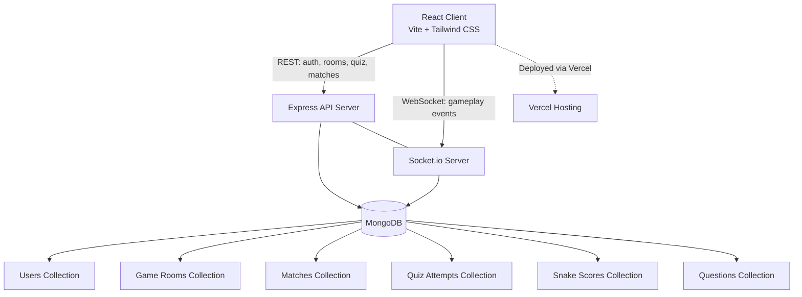

# 🎮 GameSphere — System Architecture

**GameSphere** is a real-time, full-stack multiplayer & single-player gaming platform. Players authenticate, create or join game lobbies via room codes, compete head-to-head over WebSockets, play classic single-player arcade games, and track their stats on global leaderboards.

This document is the single source of truth for the system architecture, covering all aspects: client, server, shared layer, database, networking, security, game logic, data flow, deployment, and operations.

---

## Table of Contents

1. [Overview](#1-overview)
2. [High-Level Architecture](#2-high-level-architecture)
3. [Tech Stack](#3-tech-stack)
4. [Client Architecture](#4-client-architecture)
5. [Server Architecture](#5-server-architecture)
6. [Shared Layer](#6-shared-layer)
7. [Database Architecture](#7-database-architecture)
8. [Real-Time Communication (WebSocket)](#8-real-time-communication-websocket)
9. [REST API Architecture](#9-rest-api-architecture)
10. [Authentication & Authorization](#10-authentication--authorization)
11. [Game Logic & Rules Engine](#11-game-logic--rules-engine)
12. [Data Flow Scenarios](#12-data-flow-scenarios)
13. [Security Architecture](#13-security-architecture)
14. [Deployment Architecture](#14-deployment-architecture)
15. [Testing Strategy](#15-testing-strategy)
16. [Configuration & Constants](#16-configuration--constants)
17. [Error Handling & Resilience](#17-error-handling--resilience)
18. [Future Enhancements](#18-future-enhancements)

---

## 1. Overview

GameSphere combines competitive PvP gameplay with solo arcade experiences in a single platform:

- **Real-time PvP**: Tic Tac Toe, Rock Paper Scissors, and Guess the Number, played over WebSockets with room-code based matchmaking.
- **Single-player**: A category/difficulty-based Quiz engine and a classic Snake arcade game.
- **Persistent profiles**: Every match, quiz attempt, and Snake run is recorded against a user profile, feeding global leaderboards and per-game statistics.
- **Best-of-3 format**: All PvP games share one unified scoring model — first to 2 round wins takes the match.

---

## 2. High-Level Architecture

GameSphere follows a split architecture with a real-time layer sitting alongside a traditional REST API:



### Architectural Patterns

| Pattern | Implementation |
|---|---|
| **Client-Server** | Thin React client; thick Node.js/Express server owns business logic |
| **Dual Protocol** | REST for request/response (auth, setup, history); WebSocket for stateful real-time gameplay |
| **Server-Authoritative** | All moves, timers, win conditions validated server-side; client never decides outcomes |
| **Stateful In-Memory Game Loop** | Active rooms held in a `Map` for low-latency game ticks; persisted to MongoDB on match end |
| **Stateless Auth** | JWT verified on REST requests and WebSocket handshakes; no server-side sessions |
| **Ephemeral Lobbies** | Game rooms use TTL/cleanup so abandoned rooms are reclaimed |
| **Separation of Concerns** | Routes (HTTP), Sockets (WebSocket), Controllers (business logic), Models (data), Middleware (cross-cutting) |

---

## 3. Tech Stack

| Layer | Technology | Purpose |
|---|---|---|
| Frontend | React 18 + Vite | UI framework & build tool |
| Styling | Tailwind CSS | Utility-first styling |
| State | Zustand | Lightweight client state (auth user/token) |
| HTTP Client | Axios | REST API calls with auth interceptor |
| Real-time | Socket.io-client | WebSocket connection to game server |
| Backend | Node.js + Express | REST API server |
| Real-time Server | Socket.io | WebSocket server for live gameplay |
| Database | MongoDB + Mongoose | Document store for users, rooms, matches |
| Auth | JWT + bcrypt | Stateless authentication & password hashing |
| Rate Limiting | Express middleware | 200 requests per 15 minutes per IP |
| Hosting (Frontend) | Vercel | Static hosting with CDN |
| Hosting (Backend) | TBD | Node.js server (Docker-ready) |
| Package Manager | npm | Dependency management |
| Linting | ESLint | Code quality |

---

## 4. Client Architecture

### Directory Structure

```
client/
├── index.html
├── vite.config.js
├── tailwind.config.js
├── postcss.config.js
├── eslint.config.js
├── vercel.json
├── public/
└── src/
    ├── main.jsx              # React entry point + BrowserRouter
    ├── App.jsx               # Root component, fetches user on mount
    ├── index.css             # Global styles + Tailwind directives
    ├── routes.jsx            # Route definitions (public + protected)
    ├── components/
    │   ├── Navbar.jsx
    │   └── ProtectedRoute.jsx
    ├── pages/
    │   ├── auth/
    │   │   ├── Login.jsx
    │   │   └── Register.jsx
    │   ├── Home.jsx
    │   ├── Lobby.jsx
    │   ├── GameRoom.jsx      # PvP game room orchestration
    │   ├── Quiz.jsx          # Single-player quiz
    │   ├── Snake.jsx         # Single-player snake
    │   └── Result.jsx        # Match result screen
    ├── games/
    │   ├── ticTacToe/
    │   │   └── TicTacToe.jsx
    │   ├── rps/
    │   │   └── RockPaperScissors.jsx
    │   └── guessNumber/
    │       └── GuessNumber.jsx
    ├── services/
    │   ├── api.js            # Axios instance with auth interceptor
    │   ├── authService.js    # Login/register/me
    │   ├── roomService.js    # Room REST calls
    │   └── quizService.js    # Quiz REST calls
    ├── socket/
    │   └── socket.js         # Socket.io client singleton + connect helper
    ├── store/
    │   └── userStore.js      # Zustand store (user, token, auth actions)
    └── utils/
        ├── constants.js      # Client-side constants
        └── helpers.js        # Utility helpers
```

### Key Design Decisions

- **Vite** for fast HMR and optimized production builds.
- **Zustand** for minimal-boilerplate global auth state persisted in `localStorage`.
- **ProtectedRoute** wrapper guards `/home`, `/lobby`, `/room/:code`, `/quiz`, `/snake`, `/result/:code`.
- **Socket.io-client** with `autoConnect: false` — connection established only after auth token is available.
- **Axios interceptor** automatically attaches `Bearer <token>` from `localStorage` to every REST request.
- Each game (TicTacToe, RockPaperScissors, GuessNumber) is an isolated presentational component receiving `gameState` and `onMakeMove` callbacks from `GameRoom.jsx`.

### Routing Table

| Path | Component | Auth | Purpose |
|---|---|---|---|
| `/` | Login | No | Landing / login |
| `/login` | Login | No | User login |
| `/register` | Register | No | User registration |
| `/home` | Home | Yes | Dashboard / game selection |
| `/lobby` | Lobby | Yes | Create/join room lobby |
| `/room/:code` | GameRoom | Yes | PvP gameplay room |
| `/quiz` | Quiz | Yes | Single-player quiz |
| `/snake` | Snake | Yes | Single-player snake |
| `/result/:roomCode` | Result | Yes | Match result screen |

---

## 5. Server Architecture

### Directory Structure

```
server/
├── .env
├── package.json
├── package-lock.json
└── src/
    ├── app.js            # Express app: CORS, body parsing, rate limiting, routes, error handler
    ├── server.js         # Entry: env validation, HTTP server, Socket.io, DB connect, listen
    ├── config/
    │   └── constants.js  # Server constants (currently empty)
    ├── controllers/
    │   ├── authController.js
    │   ├── matchController.js
    │   ├── quizController.js
    │   ├── roomController.js
    │   └── userController.js
    ├── middleware/
    │   ├── auth.js         # JWT verification for REST
    │   ├── errorHandler.js # Centralized error handling
    │   ├── rateLimiter.js  # Express rate limiting
    │   └── validation.js   # Request validation
    ├── models/
    │   ├── User.js
    │   ├── GameRoom.js
    │   ├── Match.js
    │   ├── Question.js
    │   ├── QuizAttempt.js
    │   └── SnakeScore.js
    ├── routes/
    │   ├── authRoutes.js
    │   ├── matchRoutes.js
    │   ├── roomRoutes.js
    │   ├── quizRoutes.js
    │   └── userRoutes.js
    ├── sockets/
    │   └── gameHandler.js  # Socket.io connection handling + game loops
    └── utils/
        └── generateRoomCode.js
```

### Server Startup Flow

1. `server.js` loads `.env` via `dotenv`.
2. Validates required env vars: `JWT_SECRET`, `MONGO_URI` (exits if missing).
3. Sets DNS servers (`8.8.8.8`, `1.1.1.1`) for MongoDB SRV resolution in dev.
4. Creates Express app (`app.js`) and wraps it in `http.createServer`.
5. Initializes Socket.io server attached to the same HTTP instance.
6. Applies JWT auth middleware to Socket.io connections (rejects unauthenticated sockets).
7. Registers game socket handlers via `handleGameSockets(io)`.
8. Connects to MongoDB via Mongoose.
9. Listens on `PORT` (default `5000`).

### CORS Configuration

- Allowed origins: `http://localhost:5173` and `process.env.CLIENT_URL`.
- `credentials: true` for cookie/auth header forwarding.
- Dynamic origin validation callback.

### Rate Limiting

- Applied to all `/api` routes: 200 requests per 15-minute window per IP.

---

## 6. Shared Layer

The `shared/` directory holds code imported by **both** client and server (where applicable), ensuring a single source of truth for game rules and configuration.

### shared/constants.js — `GAME_CONFIG`

| Namespace | Key | Value | Description |
|---|---|---|---|
| root | `roomCodeLength` | 6 | Length of generated room codes |
| root | `roomExpireMinutes` | 60 | Room TTL in minutes |
| tictactoe | `moveTimeLimitSeconds` | 5 | Seconds per move |
| tictactoe | `boardSize` | 3 | Grid dimension |
| tictactoe | `pointsPerWin` | 1 | Points per round win |
| rps | `choiceTimeLimitSeconds` | 5 | Seconds per choice |
| rps | `revealDelaySeconds` | 1 | Delay before reveal |
| rps | `pointsPerWin` | 1 | Points per round win |
| guessNumber | `guessTimeLimitSeconds` | 5 | Seconds per guess |
| guessNumber | `maxGuessesPerRound` | 3 | Max attempts per round |
| guessNumber | `numberMin` | 1 | Lower bound of secret number |
| guessNumber | `numberMax` | 100 | Upper bound of secret number |
| guessNumber | `pointsPerWin` | 1 | Points per round win |
| quiz | `questionTimeLimitSeconds` | 45 | Seconds per question |
| quiz | `maxQuestionsPerSession` | 15 | Max questions per quiz |
| quiz | `minQuestionsForScore` | 10 | Min questions for valid score |
| snake | `pointsPerFood` | 10 | Points per food eaten |
| snake | `initialLength` | 3 | Starting snake length |
| snake | `boardWidth` | 400 | Canvas width |
| snake | `boardHeight` | 400 | Canvas height |
| matchFormat | `pointsToWin` | 2 | First to N points wins match |
| matchFormat | `totalRounds` | 3 | Max rounds if needed |

### shared/eventNames.js

Canonical WebSocket event names used by both client and server:

| Event | Direction | Purpose |
|---|---|---|
| `create-room` | C→S | Create a new game room |
| `join-room` | C→S | Join an existing room by code |
| `room-update` | S→C | Broadcast lobby state (players, status) |
| `game-state-sync` | S→C | Full game state synchronization |
| `game-started` | S→C | Round/match start notification |
| `make-move` | C→S | Submit a move (Tic Tac Toe) |
| `opponent-move` | S→C | Broadcast opponent's move/state |
| `round-result` | S→C | Round conclusion with scores |
| `match-result` | S→C | Match conclusion with final winner |
| `opponent-disconnected` | S→C | Opponent drop notification |
| `game-ended` | S→C | Final match cleanup notification |

### shared/gameRules.js — Pure Game Logic

Pure, side-effect-free functions imported by the server's `gameHandler.js`:

| Function | Input | Output | Description |
|---|---|---|---|
| `checkTicTacToeWin(board)` | `string[]` (length 9) | `"X"`, `"O"`, or `null` | Detects 3-in-a-row win |
| `checkRPSWin(p1Move, p2Move)` | `"R"`, `"P"`, `"S"` | `"player1"`, `"player2"`, `"draw"` | RPS outcome resolution |
| `getGuessHint(guess, secretNumber)` | `number`, `number` | `"Correct!"`, `"Too high"`, `"Too low"` | Guess the Number hint |

---

## 7. Database Architecture

**Database**: MongoDB (Mongoose ODM). Connection string via `MONGO_URI` env var.

### Collection: `users`

```js
{
  _id: ObjectId,
  name: String (unique, required),
  email: String (unique, required, lowercase),
  password: String (required, bcrypt hash),
  totalMatches: Number (default 0),
  totalWins: Number (default 0),
  totalLosses: Number (default 0),
  stats: {
    tictactoe: { wins, losses, totalRounds },
    rockpaperscissors: { wins, losses, totalRounds },
    guessNumber: { wins, losses, totalRounds },
    quiz: { totalAttempts, avgScore },
    snake: { bestScore }
  },
  avatar: String,
  lastLogin: Date
}
```

**Indexes**: `stats.tictactoe.wins`, `stats.rockpaperscissors.wins`, `stats.guessNumber.wins`, `stats.snake.bestScore` (all descending for leaderboards).

### Collection: `gameRooms`

```js
{
  _id: ObjectId,
  code: String (unique, required),          // 6-char room code
  gameType: String (enum: tic-tac-toe, rock-paper-scissors, guess-number),
  players: [{ userId: ObjectId (ref User), name: String, joinedAt: Date }],
  status: String (enum: waiting, in-progress, completed, default waiting),
  createdAt: Date (default now)
}
```

**Note**: The `expiresAt` TTL field mentioned in the README is planned but not yet in the schema.

### Collection: `matches` — one record per completed PvP match

```js
{
  _id: ObjectId,
  roomId: ObjectId (ref GameRoom),
  roomCode: String,
  gameType: String (enum: tic-tac-toe, rock-paper-scissors, guess-number),
  player1Id: ObjectId (ref User),
  player2Id: ObjectId (ref User),
  winnerId: ObjectId (ref User),
  loserId: ObjectId (ref User),
  rounds: [
    { roundNumber: Number, player1Move: Mixed, player2Move: Mixed, winner: String (enum), duration: Number }
  ],
  finalWinner: String (enum: player1, player2, draw),
  player1Score: Number (default 0),
  player2Score: Number (default 0),
  totalDuration: Number,
  completedAt: Date (default now),
  createdAt: Date (default now)
}
```

**Indexes**: `player1Id + createdAt`, `player2Id + createdAt`, `roomCode`.

### Collection: `questions`

```js
{
  _id: ObjectId,
  category: String (DSA, Aptitude, WebDev),
  difficulty: String (easy, medium, hard),
  question: String,
  options: [String],          // 4 options
  correctAnswer: Number,      // index of correct option (0-3)
  explanation: String,
  createdAt: Date,
  updatedAt: Date
}
```

### Collection: `quizAttempts`

```js
{
  _id: ObjectId,
  userId: ObjectId (ref User),
  category: String,
  difficulty: String,
  questions: [{ quizId: ObjectId, selectedAnswer: Number, isCorrect: Boolean, timeTaken: Number }],
  totalCorrect: Number,
  totalQuestions: Number,
  score: Number,              // percentage
  startedAt: Date,
  completedAt: Date
}
```

### Collection: `snakeScores`

```js
{
  _id: ObjectId,
  userId: ObjectId (ref User),
  score: Number,
  foodEaten: Number,
  duration: Number,
  playedAt: Date
}
```

### Data Relationships

- `User` 1:N `Match` (as player1 or player2)
- `User` 1:N `QuizAttempt`
- `User` 1:N `SnakeScore`
- `GameRoom` 1:N `Match`
- `User` has embedded `stats` subdocument per game type (denormalized for fast leaderboard reads)

---

## 8. Real-Time Communication (WebSocket)

### Transport

- **Library**: Socket.io (server) + Socket.io-client (client).
- **Transports**: `websocket` only (polling disabled).
- **Port**: Same HTTP server port as Express (default `5000`).
- **CORS**: Configured with `CLIENT_URL` origin, `credentials: true`.

### Authentication

Every WebSocket connection must pass JWT auth middleware (`io.use`):

1. Client sends `token` in `auth` during handshake.
2. Server verifies JWT against `JWT_SECRET`.
3. On success, attaches `socket.user = { id, name }` and calls `next()`.
4. On failure, connection is rejected with an authentication error.

### Connection Lifecycle

1. Client calls `connectSocket()` → sets `socket.auth.token` → calls `socket.connect()`.
2. Server authenticates via middleware, logs the connection.
3. Client emits `join-room { roomCode }`.
4. Server validates room exists and user is a registered player.
5. Socket joins the room namespace (`socket.join(roomCode)`).
6. Server initializes or retrieves in-memory room state from `activeRooms` Map.
7. Server emits `room-update` to all room members and `game-state-sync` to the joining client.
8. When 2 players are present and status is `waiting`, server auto-starts the game after 500ms.

### In-Memory Room State (`activeRooms` Map)

Key: `roomCode` (string). Value: room state object containing:

- `gameType`, `roomId`, `players[]` (socketId, userId, username, ready)
- `currentRound`, `p1Score`, `p2Score`, `status`
- `roundsData[]`, `matchStartTime`, `roundStartTime`
- Game-specific fields: `board`, `turnIndex`, `p1Move`, `p2Move`, `secretNumber`, `guessesLeft`, `pickerIndex`, `guesserIndex`
- `timer` (setTimeout reference), `disconnectTimeout` (setTimeout reference)

### WebSocket Events — Client → Server

| Event | Payload | Server Handler |
|---|---|---|
| `create-room` | `{ gameType }` | Creates room in DB, returns code |
| `join-room` | `{ roomCode }` | Validates, joins socket, syncs state |
| `make-move` | `{ roomCode, move }` | Delegates to game-specific handler |

### WebSocket Events — Server → Client (Broadcast to Room)

| Event | Payload | Trigger |
|---|---|---|
| `room-update` | `{ players, status, gameType }` | Player joins/leaves lobby |
| `game-state-sync` | `{ players, status, gameType, currentRound, p1Score, p2Score, board, turnIndex, ... }` | State change / join / round start |
| `game-started` | `{ round, gameType, players, turnIndex, board, pickerIndex, guesserIndex }` | Match or round start |
| `opponent-move` | `{ board, turnIndex, lastMove, hint, guessesLeft, p1Choice, p2Choice, ... }` | Opponent action |
| `round-result` | `{ round, winner, p1Score, p2Score, nextRoundStartsIn }` | Round ended |
| `match-result` | `{ finalWinner, p1Score, p2Score, matchId }` | Match ended |
| `opponent-disconnected` | `{ message }` | Opponent dropped mid-match |
| `game-ended` | `{ roomCode, winner, loser, score, duration }` | Final cleanup |

### Game Loop (Server-Side)

```
join-room (2 players) → startGame → startRound → [player moves] → endRound → (score >= 2 ? endMatch : startRound)
```

**Per-game round handling**:

1. **Tic Tac Toe**: Board initialized to 9 nulls. `turnIndex` alternates. Players place X/O. Win detected via `checkTicTacToeWin`; draw if board full. Timeout → opponent wins round.
2. **Rock Paper Scissors**: Both players submit choices simultaneously. Revealed together. `checkRPSWin` resolves. Timeout → non-missing player wins; both missing → draw.
3. **Guess the Number**: Roles swap each round (`pickerIndex = (round-1) % 2`). Picker sets secret number (15s timer). Guesser has 3 attempts with hints. Timeout → appropriate forfeit.

**Disconnect handling**: On socket disconnect during an in-progress match, opponent is notified and a 30-second grace period starts. If the disconnected player doesn't return, the opponent wins by default (`endMatch` with `forcedWinnerIdx`).

**Match persistence**: On match end, a `Match` document is saved, both `User` stats are updated (wins/losses/totalRounds/totalMatches), the `GameRoom` status is set to `completed`, and `match-result` + `game-ended` events are emitted. The room is then removed from `activeRooms`.

---

## 9. REST API Architecture

### Base URL & Configuration

- Base: `${VITE_API_URL}/api` (Axios instance in `client/src/services/api.js`).
- Auth: `Authorization: Bearer <token>` header auto-attached via Axios request interceptor.
- Rate limit: 200 req / 15 min per IP.

### Route Structure

| Route File | Mount Path | Responsibility |
|---|---|---|
| `authRoutes.js` | `/api/auth` | Registration, login, logout |
| `userRoutes.js` | `/api/user` | Profile fetch/update |
| `roomRoutes.js` | `/api/rooms` | Room creation, fetch, join |
| `matchRoutes.js` | `/api/matches` | Match history by user or ID |
| `quizRoutes.js` | `/api/quiz` | Question fetching, attempt submission |

### Authentication Endpoints

| Method | Endpoint | Body | Response | Auth |
|---|---|---|---|---|
| POST | `/api/auth/register` | `{ email, password, username }` | `{ userId, token, message }` | No |
| POST | `/api/auth/login` | `{ email, password }` | `{ userId, token, user }` | No |
| POST | `/api/auth/logout` | — | `{ message }` | Yes |

### User Profile Endpoints

| Method | Endpoint | Body | Response | Auth |
|---|---|---|---|---|
| GET | `/api/user/profile/:userId` | — | `{ userId, email, username, stats, recentMatches }` | Yes |
| PUT | `/api/user/profile/:userId` | `{ username, avatar }` | `{ message }` | Yes |

### Room Endpoints

| Method | Endpoint | Body | Response | Auth |
|---|---|---|---|---|
| POST | `/api/rooms/create` | `{ gameType }` | `{ roomCode, roomId, expiresAt }` | Yes |
| GET | `/api/rooms/:roomId` | — | `{ roomId, gameType, players, status, expiresAt }` | Yes |
| POST | `/api/rooms/:roomId/join` | `{ userId }` | `{ message, roomId, opponent }` | Yes |

### Match Endpoints

| Method | Endpoint | Response | Auth |
|---|---|---|---|
| GET | `/api/matches/user/:userId` | Array of `{ matchId, opponent, gameType, result, score, playedAt }` | Yes |
| GET | `/api/matches/:matchId` | `{ matchId, players, gameType, rounds, finalWinner, completedAt }` | Yes |

### Quiz Endpoints

| Method | Endpoint | Body | Response | Auth |
|---|---|---|---|---|
| GET | `/api/quiz/questions/:category/:difficulty` | — | Array of `{ quizId, category, difficulty, question, options }` (no correct answer) | Yes |
| POST | `/api/quiz/submit` | `{ category, difficulty, answers: [{ quizId, selectedAnswer, timeTaken }] }` | `{ score, totalCorrect, totalQuestions, breakdown }` | Yes |

### Leaderboard Endpoint

| Method | Endpoint | Response | Auth |
|---|---|---|---|
| GET | `/api/leaderboard/:gameType` | Array of `{ rank, username, wins, winRate, matchesPlayed }` | Yes |

### Middleware Stack (per request)

1. CORS preflight & origin validation.
2. `express.json()` body parsing.
3. Rate limiter (`/api` scope).
4. Route-specific controllers.
5. Auth middleware (`auth.js`) on protected routes — verifies JWT, attaches `req.user`.
6. Validation middleware (`validation.js`) on mutating routes.
7. Centralized `errorHandler.js` — catches async errors, returns standardized JSON error responses.

---

## 10. Authentication & Authorization

### Token Format

- **JWT** signed with `JWT_SECRET` (HS256).
- Payload contains `userId` and `name`.
- Stored in `localStorage` under key `"token"`.
- User profile stored in `localStorage` under key `"user"`.

### Auth Flow

```
Client: Login/Register → Server validates credentials → Server issues JWT → Client stores token in localStorage
      ↓
Client: Subsequent REST requests → Axios interceptor attaches Bearer token → Server verifies via auth middleware
      ↓
Client: WebSocket connect → socket.auth.token sent → Server io.use middleware verifies JWT → socket.user populated
```

### Authorization Model

- **Public**: Login, register.
- **Authenticated (JWT required)**: Profile, rooms, matches, quiz, all WebSocket connections.
- **Room-scoped**: WebSocket `join-room` validates that the authenticated user is a registered player in the target room.
- **Resource ownership**: Match history and quiz attempts are scoped to the authenticated `userId`.

### Password Security

- Passwords hashed with **bcrypt** before storage.
- Plaintext passwords never logged or returned in API responses.

---

## 11. Game Logic & Rules Engine

### Game Rules Source of Truth

`shared/gameRules.js` exports pure functions:

- `checkTicTacToeWin(board)` — win detection for 3×3 grid.
- `checkRPSWin(p1, p2)` — Rock Paper Scissors outcome.
- `getGuessHint(guess, secret)` — hint generation.

These are imported by `server/src/sockets/gameHandler.js`, keeping game logic decoupled from networking.

### Match Format (Best-of-3)

- 1 point per round win.
- First to **2 points** wins the match immediately (no 3rd round if 2–0).
- Final result displayed as `Player A Wins 2-0` or `Player A Wins 2-1`.
- Draw possible if both players reach the same score after 3 rounds.

### Per-Game Rules

| Game | Players | Format | Time Limit | Key Rules |
|---|---|---|---|---|
| Tic Tac Toe | 2 | Best-of-3 | 5s/move | Alternating turns, win/draw/timeout |
| Rock Paper Scissors | 2 | Best-of-3 | 5s/choice | Simultaneous reveal, draw = no points |
| Guess the Number | 2 | Best-of-3 | 5s/guess | Picker/guesser swap each round, 3 max guesses |
| Quiz | 1 | 10–15 questions | 45s/question | MCQ, category + difficulty, score = % correct |
| Snake | 1 | Endless | None | Eat food (+10 pts), wall/self collision = game over |

### Server-Authoritative Validation

- Every move/guess/choice is validated on the server before state mutation.
- Client cannot send forged outcomes, scores, or round results.
- Quiz correct answers are never sent to the client; grading happens server-side.
- Timers are enforced server-side (`setTimeout`), not just visually on the client.

---

## 12. Data Flow Scenarios

### 12.1 User Registration & Login

```
Client (Login/Register page)
  → POST /api/auth/register or /api/auth/login
  → authController validates credentials, hashes password (bcrypt), creates User
  → Server signs JWT, returns { token, user }
  → Client stores token + user in localStorage + Zustand store
  → Client redirects to /home
```

### 12.2 Creating & Joining a PvP Room

```
Client A (Lobby page)
  → POST /api/rooms/create { gameType }
  → roomController generates 6-char code, saves GameRoom (status: waiting)
  → Returns { roomCode, roomId }
  → Client A navigates to /room/:code
  → Client A fetches GET /api/rooms/:code, connects Socket.io, emits join-room
  → Server validates room + player registration, socket joins room namespace
  → Server emits room-update to room members
Client B (enters same code)
  → Same flow; socket joins same room namespace
  → Server detects 2 players, status waiting → auto-starts game after 500ms
```

### 12.3 PvP Gameplay (Tic Tac Toe Example)

```
Server: startGame → startRound (board = [null×9], turnIndex = 0)
  → emit game-started to room
  → startTimer (5s)

Player 0 (turn)
  → Client emits make-move { roomCode, move: { position: 4 } }
  → Server: handleTicTacToeMove validates turn, bounds, empty cell
  → Server updates board, emits opponent-move { board, turnIndex: 1 }
  → Server: checkTicTacToeWin → if win, endRound; else restart timer for player 1

endRound:
  → clearTimeout timer
  → Update scores, push round to roundsData
  → emit round-result { round, winner, p1Score, p2Score }
  → If score >= 2 → endMatch; else startRound after 3s

endMatch:
  → Save Match document to MongoDB
  → Update both User stats (wins/losses/totalRounds/totalMatches)
  → Set GameRoom status to completed
  → emit match-result + game-ended to room
  → Delete room from activeRooms Map
```

### 12.4 Single-Player Quiz

```
Client (Quiz page)
  → GET /api/quiz/questions/:category/:difficulty
  → quizController fetches questions from DB, strips correctAnswer, returns options only
  → Client answers each question within 45s (client-side visual timer)
  → Client POST /api/quiz/submit { category, difficulty, answers: [...] }
  → quizController grades answers server-side against correctAnswer
  → Server saves QuizAttempt document, updates User.stats.quiz
  → Returns { score, totalCorrect, totalQuestions, breakdown }
```

### 12.5 Single-Player Snake

```
Client (Snake page)
  → Game runs entirely client-side (canvas, movement, collision, food spawning)
  → On game over, Client POST /api/user/profile/:userId or snake score endpoint
  → Server saves SnakeScore document, updates User.stats.snake.bestScore if higher
```

### 12.6 Match History & Leaderboard

```
Client → GET /api/matches/user/:userId
  → matchController queries Match collection by player1Id or player2Id
  → Returns historical matches

Client → GET /api/leaderboard/:gameType
  → Server queries User collection, sorts by stats.<gameType>.wins or stats.snake.bestScore
  → Returns ranked list
```

---

## 13. Security Architecture

| Layer | Control | Implementation |
|---|---|---|
| Transport | CORS | Allowed origins list; credentials enabled |
| Auth | JWT | Stateless tokens verified on REST + WebSocket |
| Passwords | bcrypt | Hashed at rest; never logged |
| Input Validation | Server-side | All moves, guesses, choices validated before state change |
| Rate Limiting | Express middleware | 200 req / 15 min per IP on `/api` |
| Game Integrity | Server-authoritative | Client never trusted for outcomes, scores, or timers |
| Quiz Secrecy | Server-side grading | Correct answers excluded from question payload |
| Room Access | Membership check | `join-room` validates user is a registered player |
| Disconnect Safety | Grace period | 30s forfeit timeout; opponent wins by default |
| Env Secrets | `.env` | `JWT_SECRET`, `MONGO_URI` not committed; validated at startup |

### Threat Model & Mitigations

| Threat | Mitigation |
|---|---|
| Client sends fake move to win | Server validates turn, bounds, cell emptiness; rejects invalid moves |
| Client inspects quiz answers | Correct answers never included in GET /questions response |
| Brute-force login | Rate limiting on `/api/auth` endpoints |
| Room code guessing | 6-char alphanumeric codes; membership validation on join |
| Token theft | short-lived tokens recommended; stored in localStorage (XSS risk — consider httpOnly cookies in production) |
| DoS via rapid connections | Rate limiting + Socket.io connection limits |
| Abandoned rooms | Room status tracking; disconnect timeout cleanup |

---

## 14. Deployment Architecture

### Frontend (Vercel)

- Static build via `vite build` → `dist/` directory.
- Deployed to Vercel with automatic CI/CD from GitHub.
- `vercel.json` configures routing and SPA fallback.
- Environment variables: `VITE_API_URL`, `VITE_SOCKET_URL`.

### Backend (Node.js)

- Entry: `server/src/server.js`.
- Process manager: PM2 or systemd (production).
- Container-ready: Dockerfile recommended.
- Environment variables: `PORT`, `JWT_SECRET`, `MONGO_URI`, `CLIENT_URL`.

### Database (MongoDB)

- MongoDB Atlas (cloud) or self-hosted.
- Connection via `mongodb+srv://` SRV URI.
- DNS fallback to `8.8.8.8` / `1.1.1.1` for SRV resolution in dev.

### Network Topology

```
Internet
  ↓
Vercel Edge (React SPA, static assets)
  ↓ HTTPS REST (api.game-sphere.com)
Backend Server (Node.js + Express + Socket.io)
  ↓ MongoDB driver
MongoDB Atlas (users, rooms, matches, quizzes, snake scores)
```

---

## 15. Testing Strategy

### Testing Checklist

- [ ] Two players can join the same room via code
- [ ] Timer enforces 5-second limits in Tic Tac Toe
- [ ] RPS reveals only after both players have chosen, or on timeout
- [ ] Guess the Number correctly swaps picker/guesser roles each round
- [ ] Quiz enforces the 45-second per-question limit
- [ ] Points system correctly calculates round and match winners
- [ ] Best-of-3 closes immediately once a player reaches 2 points
- [ ] All completed games persist correctly to the database
- [ ] WebSocket reconnection works as expected
- [ ] Opponent disconnect triggers the correct default-win message

### Recommended Test Layers

| Layer | Scope | Tools |
|---|---|---|
| Unit | `shared/gameRules.js` pure functions | Jest / Vitest |
| Integration | REST API endpoints (auth, rooms, quiz, matches) | Supertest + Jest |
| Integration | WebSocket game loops & disconnection | socket.io-client + Jest |
| E2E | Full user journeys (register → create room → play → result) | Playwright / Cypress |
| Load | Concurrent WebSocket connections | Artillery / k6 |

### Test Environment

- Separate test MongoDB database or in-memory MongoDB (`mongodb-memory-server`).
- `JWT_SECRET` set to a test value.
- Rate limits relaxed or disabled in test config.

---

## 16. Configuration & Constants

### Server Environment Variables (`.env`)

| Variable | Required | Description | Example |
|---|---|---|---|
| `PORT` | No | Server port | `5000` |
| `JWT_SECRET` | Yes | JWT signing secret | `random-256-bit-secret` |
| `MONGO_URI` | Yes | MongoDB connection string | `mongodb+srv://...` |
| `CLIENT_URL` | No | Frontend origin for CORS | `https://game-sphere.vercel.app` |

### Client Environment Variables (`.env` / Vite)

| Variable | Description | Example |
|---|---|---|
| `VITE_API_URL` | REST API base URL | `http://localhost:5000` |
| `VITE_SOCKET_URL` | WebSocket server URL | `http://localhost:5000` |

### Game Configuration

Single source of truth: `shared/constants.js` → `GAME_CONFIG` object (detailed in Section 6).

---

## 17. Error Handling & Resilience

### Server-Side Error Handling

- **Centralized error handler** (`middleware/errorHandler.js`): catches all async route errors, returns standardized JSON `{ error, message }` with appropriate HTTP status codes.
- **Socket.io errors**: Emitted as `error` event to the client (`{ message }`).
- **DB connection failure**: `mongoose.connect` catch logs error; process does not exit (reconnect handled by Mongoose).
- **Missing env vars**: `server.js` validates `JWT_SECRET` and `MONGO_URI` at startup; exits with code 1 if missing.

### Client-Side Error Handling

- Axios interceptor: request errors (401) can trigger logout/redirect to login.
- `ProtectedRoute`: redirects unauthenticated users to `/login`.
- `GameRoom.jsx`: displays error state if room fetch fails.
- Socket reconnection: `connect` event re-emits `join-room` to re-sync state.

### Resilience Patterns

| Concern | Pattern |
|---|---|
| Stale room state | `activeRooms` Map cleared on match end; TTL planned for rooms |
| Disconnected player | 30s grace period, then forfeit win for opponent |
| Reconnection | Client re-emits `join-room` on `connect`; server restores socketId |
| Timer drift | Server `setTimeout` is authoritative; client is passive |
| Partial match data | Match saved atomically on `endMatch`; stats updated in same transaction block |

---

## 18. Future Enhancements

| Enhancement | Description | Architecture Impact |
|---|---|---|
| Multiplayer leaderboard | Global PvP rankings | New leaderboard query on User stats |
| Friend system | User friend lists, invites | New `friends` collection; REST endpoints |
| Achievements / badges | Unlockable milestones | New `achievements` collection; event-driven triggers |
| Ranked mode | Skill-based matchmaking | ELO/rating field on User; matchmaking service |
| AI opponent | Single-player PvP practice | Bot player in `activeRooms`; game logic unchanged |
| In-game chat | Real-time text chat | New WebSocket events; `chatMessages` collection |
| Tournament mode | Bracket-based competitions | New `tournaments` collection; scheduling logic |
| Mobile app | React Native / Flutter | Same backend API + WebSocket; new client |
| httpOnly cookies | More secure token storage | Change auth transport from localStorage to cookies |
| Room TTL cleanup | Automatic expired room removal | MongoDB TTL index on `expiresAt` field |
| Docker / K8s | Containerized deployment | Dockerfile, docker-compose, K8s manifests |
| CI/CD pipeline | Automated testing & deploy | GitHub Actions workflow |

---

## Document Control

| Field | Value |
|---|---|
| Project | GameSphere |
| Document | System Architecture |
| Location | `architecture.md` (project root) |
| Status | Current / Pre-Development Planning |
| Owner | Vijay Prakash Gupta |
| Source of Truth | `shared/constants.js`, `shared/gameRules.js`, `shared/eventNames.js`, `server/src/`, `client/src/` |

This document is intended to be updated as the codebase evolves. When game rules, constants, or event names change in code, update `architecture.md` accordingly to keep documentation and implementation in sync.